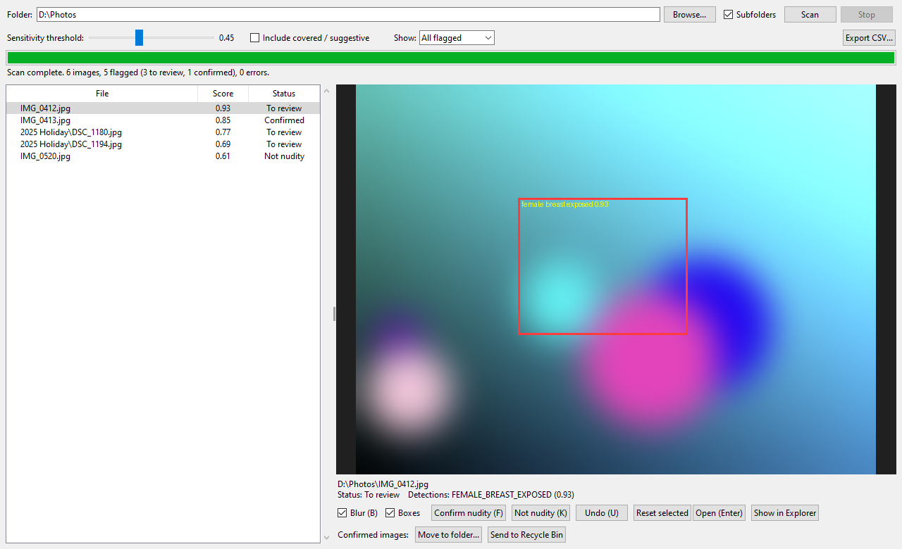

# NSFW Photo Scanner

**Scan a folder of photos for nudity, then quickly review, sort or remove what it finds. Runs 100% offline on Windows.**

NSFW Photo Scanner uses the open-source [NudeNet](https://github.com/notAI-tech/NudeNet) detector to flag images that likely contain nudity, then gives you a review window to confirm or dismiss each flag. No images are ever uploaded anywhere: the model runs locally on your CPU. Please read [About the detection model](#about-the-detection-model) for an important note on where the model came from.



## Features

- **Fully offline and private.** Detection runs on your machine and nothing leaves it.
- **Blurred previews by default**, with boxes around what was detected. Press `B` to unblur.
- **Fast keyboard review.** `F` confirms, `K` marks as not nudity, `U` undoes. The list advances as you go.
- **Live sensitivity.** Adjust the threshold, or include covered/suggestive content, after scanning without rescanning.
- **Bulk actions on confirmed images:** move them to a folder (keeping subfolder structure) or send them to the Recycle Bin.
- **Resume later.** Review progress auto-saves per folder.
- **CSV export** of every image, its review status, scores and detected labels.
- Handles JPG, PNG, WEBP, BMP, TIFF, GIF and iPhone **HEIC**. Photos are auto-rotated from EXIF before detection.
- Includes a **command-line version** (`scan_nudity.py`) for scripting or batch jobs.

## Getting started

**This project is distributed as source code only.** There is no ready-made exe to download. The detection model (NudeNet) is believed to have been trained on a dataset that contained child sexual abuse material (see [About the detection model](#about-the-detection-model)), so this project doesn't redistribute the model itself. When you install the requirements, the model comes directly from the upstream `nudenet` package on PyPI.

To use the tool, [run it from source](#run-from-source) (about five minutes), or [build your own exe](#build-the-exe-yourself) on your own PC.

## How to use

1. **Browse…** to a photo folder, choose whether to include subfolders, and press **Scan**.
2. Flagged images appear in the list as the scan runs. Click one to preview it.
3. Review each one:

| Key | Action |
|---|---|
| `F` | Confirm nudity |
| `K` | Not nudity (false alarm) |
| `U` / `Ctrl+Z` | Undo the last action (repeatable) |
| `B` | Toggle blur |
| `Enter` / double-click | Open in your default image viewer |
| `↑` `↓` | Move through the list |

Select several rows (Shift/Ctrl-click) to mark them all at once.

4. Use **Show:** to switch views: *To review*, *All flagged*, *Confirmed*, *Not nudity*, *Errors* or *All images*. **Reset selected** sends images back to *To review*.
5. When done, act on everything marked *Confirmed*:
   - **Move to folder…** moves the files out and keeps the subfolder layout. Name clashes are renamed, never overwritten.
   - **Send to Recycle Bin** can be restored from the Recycle Bin.
   - **Export CSV…** saves a full report.

Your original files are never changed unless you use Move or Recycle.

### Sensitivity

- **Threshold** (default `0.45`) is the minimum detection confidence needed to flag an image. Lower it to catch more (with more false alarms); raise it for fewer false alarms.
- **Include covered / suggestive** also flags covered breasts, genitals and buttocks, such as lingerie or swimwear.

Both settings re-filter the existing scan instantly. Scan once, then tune.

### What counts as a flag

By default these NudeNet labels count:

`FEMALE_BREAST_EXPOSED`, `FEMALE_GENITALIA_EXPOSED`, `MALE_GENITALIA_EXPOSED`, `BUTTOCKS_EXPOSED`, `ANUS_EXPOSED`

With *Include covered*, these are added: `FEMALE_BREAST_COVERED`, `FEMALE_GENITALIA_COVERED`, `BUTTOCKS_COVERED`, `ANUS_COVERED`

## Limitations

This is a probabilistic detector, not a guarantee. **Treat flags as "review this", not as a verdict.**

- **False positives:** skin-heavy beach or gym photos, babies in the bath, some artwork. My sphynx cats flagged as genitalia on my test runs.
- **Misses:** unusual angles, very dark, small or low-resolution images, drawings and illustrations, partially visible subjects.
- Video files aren't scanned, and only the first frame of an animated GIF is checked.
- Speed depends on your CPU. Large photos are downscaled before detection, since the model works at 320 px internally.

## About the detection model

This tool uses NudeNet's pre-trained detector (`320n.onnx`), which is bundled in the `nudenet` Python package (and in any exe you build yourself). **You should know where that model comes from before using it.**

In October 2025 the Canadian Centre for Child Protection (C3P) [reported](https://protectchildren.ca/en/press-and-media/news-releases/2025/csam-nude-net) that the NudeNet *image dataset*, about 700,000 images scraped from the internet and distributed via Academic Torrents since 2019, contained nearly 680 images known or suspected to be child sexual abuse and exploitation material. The dataset has since been taken down. The NudeNet detector models are generally understood to be trained on that data, and this project assumes they are.

What that means for this project:

- **No dataset images are included or downloaded.** This repository contains only code. The trained model weights, a 12 MB file of numerical parameters, are downloaded from upstream when you install `nudenet`; this project doesn't host or redistribute them. A small object-detection model like this does not store or reproduce its training images.
- **The ethical concern still applies.** The model's abilities were partly learned from images of real victims who never consented. C3P counted research projects relying on the NudeNet *model*, not just the dataset, as part of the problem's reach.
- **No vetted alternative has been found yet.** Other open-source nudity models (e.g. Falconsai, Marqo, Freepik, GantMan) train on "proprietary" or scraped data and publish no evidence of CSAM screening. If you know of an open model whose training data was screened against IWF, NCMEC or C3P hash lists, please open an issue.

This tool is **not** a CSAM detector and can't tell adults from minors. Organisations handling user uploads should use purpose-built services such as [Thorn Safer](https://safer.io/) or [Microsoft PhotoDNA](https://www.microsoft.com/en-us/photodna).

## Command-line version

```bash
pip install -r requirements.txt
python scan_nudity.py "D:/Photos"                                 # writes nudity_report.csv
python scan_nudity.py "D:/Photos" --threshold 0.3 --copy-to "D:/Flagged"
python scan_nudity.py "D:/Photos" --include-covered --move-to "D:/Flagged" --report out.csv
```

| Option | Effect |
|---|---|
| `--threshold N` | Confidence needed to flag (0–1, default 0.45) |
| `--include-covered` | Also flag covered/suggestive content |
| `--copy-to DIR` / `--move-to DIR` | Copy or move flagged images, preserving subfolders |
| `--no-recursive` | Don't scan subfolders |
| `--report FILE` | CSV report path (default `nudity_report.csv`) |

## Run from source

You need Python 3.10+ with Tkinter (included with the python.org installer).

```bash
git clone https://github.com/n-st-w/nsfw-photo-scanner.git
cd nsfw-photo-scanner
python -m venv .venv
.venv\Scripts\activate
pip install -r requirements.txt
python nudity_scanner_gui.py
```

The GUI is plain Tkinter, so it should also run on macOS and Linux from source. Some extras are Windows-specific (*Show in Explorer*; *Open* uses `os.startfile`). It has only been tested on Windows.

## Build the exe yourself

```bat
build.bat
```

This installs the build requirements into `.venv` and produces `dist\NudityScanner.exe` with PyInstaller, for use on your own PC. The exe bundles the NudeNet model downloaded from PyPI, so please read [About the detection model](#about-the-detection-model) before sharing it with anyone else.

The exe isn't code-signed, so Windows SmartScreen may warn you on first launch: click **More info → Run anyway**.

## Where data is stored

- **Review sessions:** `%LOCALAPPDATA%\NudityScanner\sessions\` (one JSON file per scanned folder: file paths, detections and review status). Delete this folder to clear history.
- Nothing is written into your photo folders unless you choose to move files.

## Responsible use

Use this tool on photos you own or are authorised to manage, for example tidying a personal library, checking a shared drive, or pre-screening content for moderation. Don't use it to surveil others or to process images of people without a lawful basis. If you come across child sexual abuse material, don't move, copy or share it: report it to your local police or a hotline such as [NCMEC](https://report.cybertip.org/), the [IWF](https://report.iwf.org.uk/) or the [eSafety Commissioner](https://www.esafety.gov.au/report) (Australia).

## License

NSFW Photo Scanner is licensed under the **GNU Affero General Public License v3.0**. See [LICENSE](LICENSE).

It builds on NudeNet (AGPL-3.0) and other open-source components. See [THIRD_PARTY_NOTICES.md](THIRD_PARTY_NOTICES.md). If you redistribute modified versions, including the exe, you must make your source available under the same licence.

This software is provided "as is", without warranty of any kind. Detection results may be wrong.

Disclosure: This software was built entirely using AI
